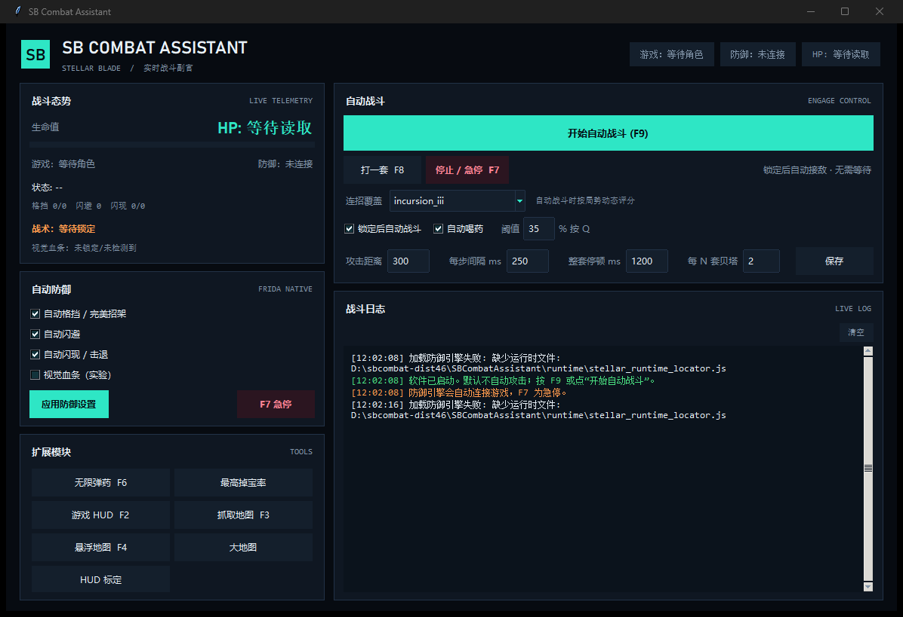

# SB Combat Assistant

《剑星》PC 版实时战斗副官。锁定敌人后接管攻击、防御与资源操作；不锁定时不主动开战，也不接管移动。

作者：彧



## 功能

- **锁定后自动战斗**：手动锁定目标后自动接敌，目标消失时停止。
- **连段系统**：轻/重攻击组合、Beta 链、Rush 链、空中连段、闪避连段。
- **动态战术**：根据距离、敌人数、韧性/疲劳、Boss 状态和连段重复度选择下一段，而不是固定循环。
- **自动防御**：格挡、闪避、完美格挡/完美闪避，由内置防御引擎处理。
- **自动喝药**：低于设定血量时使用恢复道具。
- **技能**：Beta 技能按角色选择；Burst 与迅驰模式只在满足距离、人数和 Boss 条件时使用。
- **自动索敌**：当前目标死亡后，在设定范围内重新锁定下一个目标。
- **扩展工具**：最高掉宝率、无限弹药、游戏内地图 HUD、地图抓取、悬浮地图。
- **视觉血条（实验）**：锁定后从游戏画面读取敌方血条，用于战术选择；不修改游戏数据。

## 环境

- Windows 10/11
- 《剑星》Steam 版
- Python 3.10+（源码运行）
- 游戏侧需要 UE4SS 与 `SBAutoBattleState` 状态脚本

## 运行源码

```powershell
py -m pip install -r requirements.txt
py src\sb_combat_gui.py
```

`config.example.json` 是配置模板。首次运行会在程序目录生成 `config.json`；也可以在界面中直接调整。

## 构建

```powershell
py -m pip install pyinstaller
pyinstaller --noconfirm --clean SBCombatAssistant.spec
```

生成目录为 `dist\SBCombatAssistant`。发布版已包含运行依赖。

## 热键

| 热键 | 功能 |
|---|---|
| F7 | 急停：停止连招并卸载防御引擎 |
| F8 | 打一套 |
| F9 | 开始/停止自动战斗 |
| F10 | 换一套连招 |
| F12 | 退出 |
| F2 | 游戏地图 HUD |
| F3 | 抓取游戏地图 |
| F4 | 悬浮地图 |
| F5 | HUD 标定 |
| F6 | 无限弹药 |
| Ctrl+R | 重载 UE4SS Lua 脚本（游戏内） |

## 使用流程

1. 启动游戏，进入存档。
2. 启动 `SBCombatAssistant.exe`，等待状态显示“游戏：已连接”“防御：已开启”。
3. 在游戏中手动锁定目标（默认鼠标中键）。
4. 按 F9 开始自动战斗；再次按 F9 停止。
5. 目标死亡后，程序会在自动索敌范围内寻找下一个目标。

不锁定目标时，程序不会主动攻击，也不会替你走路。

## 目录

```text
src/         Python 源码
runtime/     防御引擎与运行时定位脚本
docs/        截图
```

## 说明

- 掉宝率与弹药补丁只对当前游戏进程生效，重启游戏后需重新应用。
- 视觉血条是实验功能，仅读取屏幕，不写入游戏内存。
- 不同游戏版本的函数地址可能变化；防御引擎会在启动时做特征校验。
- 请只在单人模式使用。

## 许可

个人使用与学习。游戏素材版权归 Shift Up 所有。
